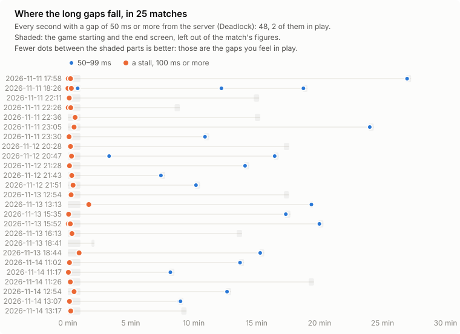

# bpfrag

eBPF-driven, self-reverting network tuning for competitive gaming on Linux.

bpfrag watches UDP traffic per process from the kernel. When a game's netcode
shows up (a steady, two-way, small-packet tick stream from a process that
is a game), it applies a networking profile for the length of the
match. When the match ends or the game exits, every change is put back
exactly as it was.

It only touches networking, plus optionally dirty-page writeback. It never
touches CPU scheduling, so it runs alongside sched_ext schedulers, and it
leaves bpftune's sysctls alone while bpftune is running (see [Running
alongside other tuners](#running-alongside-other-tuners)).

```
$ sudo bpfrag
20:14:02 INFO  bpfrag 0.12.2 started; waiting for game traffic
20:15:10 INFO  Match detected: Counter-Strike 2 (pid 6230) at ~128 pkt/s (tx 64, rx 64) -> COMPETITIVE [Steam app 730]
20:15:10 INFO  COMPETITIVE profile: net.core.rmem_max=16777216, net.core.wmem_max=16777216, ..., dscp=CS4 on enp6s0
20:52:47 INFO  Match ended after 37m37s (game exited); settings restored
20:52:47 INFO  Counter-Strike 2: packet gaps half ≤16 ms, 99% ≤19 ms, longest 31 ms, 0 stalls (100 ms+); no drops
```

## How it works

```
 kernel (BPF)                                    userspace (Rust)
 ────────────                                    ────────────────
 raw_tp sock_send_length ─┐
 raw_tp sock_recv_length ─┴─► per-process UDP ─► detector, 1 s windows:
                              (and TCP in a        steady? two-way? small packets?
                              match) counters
                                                       │
 raw_tp sched_process_exit ─► ringbuf ─────────► "game exited": end match now
                                                       │
                                                       ▼
                                                 classifier: is it really a game?
                                                 (Steam app id, launcher lineage,
                                                  Wine/Proton, allow/deny lists)
                                                       │
 tc egress (tcx link) ◄── game's UDP ports ◄──── tier from tick rate:
   rewrites DSCP                                 CASUAL / COMPETITIVE / INTENSE
                                                 apply knobs (journalled first)
 tc ingress (tcx link) ─► gaps between the ───► match health: packet gaps,
   times arrivals         game's packets         drop counters
                                                 ... match over -> restore
```

The BPF side only counts packets, reports game exits, marks packets and times
their arrival. Every decision happens in Rust, where it can be unit tested
and changed without fighting the verifier.

## What gets tuned

| Knob | CASUAL | COMPETITIVE | INTENSE |
|---|---|---|---|
| DSCP mark on the game's packets | CS4 | CS4 | CS4 |
| `net.core.{r,w}mem_max` (raise-only) | 8 MiB | 16 MiB | 32 MiB |
| `net.core.{r,w}mem_default` (raise-only) | 256 KiB | 256 KiB | 256 KiB |
| `net.ipv4.udp_early_demux` | 1 | 1 | 1 |
| `vm.dirty_bytes` / `dirty_background_bytes` (lower-only) | untouched | 256 / 64 MiB | 256 / 64 MiB |
| Wi-Fi power save (wireless interfaces) | untouched | off | off |

The buffer values come from the original bpftune gaming-tuner patches.
"Raise-only" means bpfrag never shrinks something you already sized larger,
and "lower-only" means writeback is only ever tightened. Everything is
overridable per tier (see `dist/bpfrag.toml`).

The list used to be longer. Busy polling, the receive backlog and budget
and NIC interrupt coalescing were all set once, and all came out (0.15.0
and 0.16.0) after matches with each on and off measured the same; any of
them can still be set per tier in the config.
[docs/findings.md](docs/findings.md) has the comparisons.

How much each one matters varies a lot. The clearest cases are DSCP CS4,
which gets the game's packets ahead on busy Wi-Fi and through CAKE or QoS
routers, and turning Wi-Fi power save off, which avoids wake-up delays after
lulls. The buffer headroom only matters when its drop counter moves.
**[docs/knobs.md](docs/knobs.md)** goes through every
setting: the kernel mechanism behind it, with sources, what to expect, when
nothing will happen, and how confident that is.

## How a match is detected

A process becomes a candidate after 3 seconds of steady, two-way,
small-packet UDP traffic at 25 packets/s or more, the shape of a game's
netcode. A classifier then checks it really is a game: Steam app ids, a
game library path, Wine/Proton, a launcher ancestor, gamemode or MangoHud,
and allow and deny lists, so a Discord call or a browser's QUIC traffic
doesn't count. The match starts once most of its traffic comes from
outside: a game talking to a server of its own in its menus (Deadlock
does), or checking in with relays as it starts, isn't a match. The tier
follows the rate of updates (about twice the server's tick rate) and
only goes up within a match. A match ends the moment the game exits,
after 15 quiet seconds, or once its traffic stays on the machine for 6
seconds. Games that talk only TCP (World of Warcraft, older games)
aren't tuned yet; `[detect] tcp = "observe"` logs what their
traffic looks like, to gather the data for that. To log one game's UDP and
TCP, whatever they look like, put `BPFRAG_OBSERVE=1 %command%` in its Steam
launch options.

`sudo bpfrag --dry-run -v` with `bpfrag --monitor 1` in another terminal
shows the detector's view. [docs/detection.md](docs/detection.md) has the
details: thresholds, classifier signals, tiers, and how the interfaces the
game uses are followed.
## Is it helping?

Every match gets a health report, live in `--monitor` and the Waybar
tooltip, and logged when the match ends:

```
Deadlock: packet gaps half ≤16 ms, 99% ≤23 ms, longest 48 ms, 0 stalls (100 ms+); no drops; arrives on eno1 rx queue 2, IRQ 140
```

- **Packet gaps** are timed as packets arrive, on the game's main flow. A
  64-tick server gives gaps of about 16 ms; the 99% figure, the longest gap
  and stalls (the flow going quiet for 100 ms or more mid-match) show the
  spikes you feel as rubber-banding. Only play counts: not the menus,
  the first minute's loading, maps loading mid-session, or the end
  screen.
- **Drops** are the kernel counters that grow when the receive path can't
  keep up: socket buffers, the input backlog, the NIC's ring.
- **The receive queue** is where the game's packets come in, and which IRQ
  serves it.



On a wired gigabit line, almost every long gap in 25 Deadlock matches came
while the game was starting or on its end screen, not in play, and none
of bpfrag's settings measured so far changed the figures. On a line like
that, what bpfrag tells you is whether a bad match came from this machine
or from the network and the server. Where its settings are meant to
matter, a download sharing the line or Wi-Fi, is still being measured:
[docs/findings.md](docs/findings.md).

Most of the spread in packet gaps comes from the internet and the game
server, so one match proves little either way. To find out what each
setting does, let bpfrag run an experiment: each day it picks one setting
to test, then switches it off in a random half of your matches and labels
each one.

```toml
[experiment]
setting = "random"
pool = "wired"    # or "wifi", or "auto" (by your default route)
```

`docs/scripts/matches.py --compare arm` then compares the two halves of
each day's experiment. To share your results, open a
[Share match data](https://github.com/shanefagan/bpfrag/issues/new?template=match_data.yml)
issue with the CSV that `matches.py` writes.
**[docs/measuring.md](docs/measuring.md)** has the details, and results
go in [docs/findings.md](docs/findings.md). `--dry-run` measures the same
way but changes nothing, for a baseline.

What a tier changes also depends on your distribution's defaults: `sudo
bpfrag --check` lists every setting's value now and what each tier would
set it to. [docs/distros.md](docs/distros.md) compares Ubuntu, CachyOS and
Bazzite.

## Bulk transfers during a match

A Steam download or a torrent running during a match fills the queues
the game's packets wait in. bpfrag can mark that traffic low priority
for the length of the match, so whatever honours DSCP serves the game
first. It's off by default; turn it on in `/etc/bpfrag/bpfrag.toml`:

```toml
[bulk]
enabled = true
```

- **What counts as bulk:** any process other than the game moving at
  least 2 Mbit/s (sent plus received, TCP and UDP) for 5 seconds. It stops
  being bulk after 10 seconds below that. Torrent clients count as soon as
  they move anything. OBS and other streaming hosts, voice apps, and VPN or
  overlay clients (whose traffic may be the game's) never count. The
  thresholds and both lists are in `[bulk]`.
- **What happens:** its packets get DSCP **LE** (RFC 8622 "lower effort"),
  in both directions: outgoing at tc egress, incoming at tc ingress. A
  packet the app or the sender already marked is left alone, and nothing
  changes outside a match or in a dry run.
- **Where it helps:**
  - **CAKE on this machine** (diffserv3/4/8): LE goes in the Bulk tin.
    bpfrag marks downloads before a CAKE setup's redirect to its IFB, so
    download shaping sees it too.
  - **An OpenWrt router running [dscpclassify](https://github.com/jeverley/dscpclassify):**
    it adopts the DSCP its clients set and, with its `layer_cake_ct`
    script, applies the connection's mark to the download direction as
    well. The same goes for the game's CS4.
  - **Nothing that reads DSCP:** no effect, and no harm.
- **Seeing it:** `--monitor` lists bulk processes live ("bulk: steam 38
  Mbit/s (marked LE)"), the log says when one starts and stops, and the
  match summary says how much each moved ("bulk: steam 412 MB marked
  LE"). With `[bulk]` off, they are shown but not marked, so you can see
  what it would do first. `--report` includes `tc -s qdisc`, where CAKE's
  per-tin counters show LE traffic landing in the Bulk tin.

## Running alongside other tuners

**sched_ext (scx_lavd, scx_rusty, scx_bpfland...).** There's no overlap.
bpfrag never touches CPU scheduling, priorities, affinity or frequency.
sched_ext schedulers use struct_ops, while bpfrag uses tracepoints and tc,
and the two run side by side.


**bpftune.** They do overlap, and bpfrag handles it. bpftune's sysctl watcher
switches off a whole tuner (e.g. `udp_buffer`, `net_buffer`) as soon as any
other process writes one of its sysctls. So while bpftune is running, bpfrag
yields those sysctls by default (`--bpftune auto`):

| Sysctl | Owner while bpftune runs |
|---|---|
| `rmem_max`, `rmem_default` | bpftune: it sizes these from observed drops rather than a fixed profile |
| `wmem_*`, `udp_early_demux`, DSCP, writeback | bpfrag: bpftune doesn't touch them |

In that pairing bpftune looks after capacity and bpfrag looks after latency
during matches. `bpfrag --check` shows exactly what's being yielded. Use
`--bpftune yield` to always yield, or `--bpftune ignore` to write them
anyway, which will switch off bpftune's tuners. If you're running a bpftune
build that includes the old gaming tuner patch, disable one of the two.

**gamemode** is complementary. It handles the CPU governor, GPU performance
level, niceness and ioprio, while bpfrag does the network side. They pair
well.

**tuned** profiles like network-latency set sysctls of their own
(`busy_read` and `busy_poll`, which bpfrag no longer sets). Where one
overlaps, the general rule below applies.

**General rule.** On restore, if a value no longer holds what bpfrag wrote,
someone else changed it during the match, and bpfrag leaves it alone and logs
that.

## Safety

- Every original value goes into a journal at `/run/bpfrag/journal.json`
  **before** the knob is changed. If the journal can't be written, the knob
  isn't changed. Restores run newest-first.
- If the daemon is killed or crashes, `ExecStopPost=bpfrag --restore` in the
  systemd unit puts everything back, and the next start replays any leftover
  journal. `/run` is tmpfs, so a reboot clears the journal along with the
  settings it describes.
- The DSCP marker and the arrival meter are **tcx links**, so they detach
  by themselves if the process dies. They hand every packet on to whatever
  else is on the interface: other tcx programs, classic tc filters (such as
  a desktop CAKE setup's redirect to its IFB) and the qdisc.
- `--dry-run` logs every intended change without making any of them. A lock
  file stops two instances from fighting over the same knobs.

## Install

Every [release](https://github.com/shanefagan/bpfrag/releases) has a `.deb`
(Debian 12+, Ubuntu 22.04+), an `.rpm` (current Fedora) and a binary tarball
that runs on any x86-64 distro with glibc 2.35 or newer and libdbus, all on
kernel 6.6 or newer.

Which file to download:

- **Debian, Ubuntu and derivatives:** `bpfrag_<version>-1_amd64.deb`
- **Fedora, Nobara, Bazzite:** `bpfrag-<version>-1.fc<NN>.x86_64.rpm`
  (`rpm-ostree install` it on Bazzite)
- **Anything else** (Arch, CachyOS, openSUSE...):
  `bpfrag-<version>-x86_64-linux.tar.gz`, then copy the files into
  place and run `sudo systemctl enable --now bpfrag` yourself

The rest are for checking downloads (`SHA256SUMS`), debugging
(`-debuginfo`, `-debugsource`) and rebuilding (`.src.rpm`, the vendored
crates); [packaging/release-files.md](packaging/release-files.md), which
every release page repeats, says what each one is.

The packages enable and start the service when first installed. It does
nothing until a game's match is detected. To see what this machine supports
and follow what bpfrag does:

```sh
sudo bpfrag --check && sudo bpfrag --selftest
journalctl -u bpfrag -f
```

**Building it yourself** needs Rust 1.85 or newer, clang, libclang (for
bindgen), libelf, libdbus and zlib. Packaging files are in
`packaging/`:

- **Arch, CachyOS, EndeavourOS:** `cd packaging/arch && makepkg -si`
  builds a package from what's committed.
- **Debian, Ubuntu:** `cargo deb --locked` (with
  [cargo-deb](https://github.com/kornelski/cargo-deb)), then
  `sudo apt install ./target/debian/bpfrag_*.deb`.
- **Fedora, Nobara, Bazzite:** `packaging/rpm/build.sh` builds an RPM
  offline from the committed tree (on Bazzite, in a toolbox, then
  `rpm-ostree install` it).
- **Anything else:** `just build` and `sudo just install` (DESTDIR and
  PREFIX work as usual), then `sudo systemctl daemon-reload` and
  `sudo systemctl reload dbus`.

[docs/development.md](docs/development.md) has the details for each, and
for packagers. Removing a package stops the service first, so any
settings changed mid-match are restored, and edits to
`/etc/default/bpfrag` and `/etc/bpfrag/bpfrag.toml` survive upgrades.

### Checking it on your hardware

After your first real match:

- `journalctl -u bpfrag` should show `Match detected` and then `Match ended
  ... settings restored`.
- `sysctl net.core.rmem_max` should be back at its old value.

If a restore ever fails, `sudo bpfrag --restore` replays the journal.

## Usage

```
sudo bpfrag                         run (what the service does)
sudo bpfrag --dry-run -v            detect and log, change nothing
bpfrag --monitor 1                  live view of the running instance
sudo bpfrag --check                 capabilities + bpftune/sched_ext/gamemode status
sudo bpfrag --selftest              run test packets through the tc programs on this kernel
bpfrag --waybar                     one JSON line for a status bar
sudo bpfrag --classify <PID>        would this process count as a game, and why
bpfrag --dump-config                effective config, in the TOML file's format
sudo bpfrag --restore               undo a crashed instance's changes

sudo bpfrag --tier competitive      same profile for every match
sudo bpfrag --dscp EF --iface wlan0 mark EF on wlan0 only
sudo bpfrag --allow 'Moonlight'     treat a process as a game
sudo bpfrag --stats 60              stats line in the log every minute
```

### Waybar

`bpfrag --waybar` prints one line of JSON and doesn't need root. Outside a
match the text is empty, so the module hides itself. The tooltip shows the
game, why it counts as a game, every applied setting and the last match.

```jsonc
"custom/bpfrag": {
    "exec": "bpfrag --waybar",
    "return-type": "json",
    "interval": 2,
    "format": "{}"
}
```

`alt` and `class` are `off`, `idle`, `casual`, `competitive` or `intense`, for
`format-icons` or CSS.

### D-Bus

bpfrag also publishes a read-only interface on the system bus,
`com.performativenonsense.Bpfrag1`, for programs that want to follow matches
as they happen (a status bar, OBS scene switching, clipping a recording):
whether a game is idle, in its menu or in a match, the match in
progress with its Steam app id, and signals when one starts, changes tier
and ends, with when its traffic really began and stopped and its health.
Any user can read it, and nothing on the bus can change what bpfrag does.

```sh
gdbus monitor --system --dest com.performativenonsense.Bpfrag1
```

[docs/dbus.md](docs/dbus.md) is the reference.

For the service, put flags in `/etc/default/bpfrag` as `BPFRAG_FLAGS="..."`.
Tiers, classifier lists and detector thresholds go in
`/etc/bpfrag/bpfrag.toml`; see `dist/bpfrag.toml` for an annotated example.

## Requirements

- **Kernel 6.6 or newer with BTF** (`/sys/kernel/btf/vmlinux`): UDP is
  counted with the `sock_send_length` and `sock_recv_length` tracepoints
  (6.4), and the tc programs attach as tcx links (6.6). `--check` tells
  you whether this machine qualifies.
- **Kernel lockdown, if it's on, in integrity mode.** That's the mode
  Secure Boot turns on, and the one Easy Anti-Cheat's Linux v2 asks for;
  bpfrag loads no kernel modules and only reads kernel memory, which
  integrity allows. Confidentiality mode stops BPF programs reading
  kernel memory, so bpfrag can't start there. `--check` shows the mode.
- **Root.** Under the hood it uses `CAP_BPF`, `CAP_PERFMON` and
  `CAP_NET_ADMIN`, plus `CAP_SYS_PTRACE` to read a game's
  `/proc/<pid>/environ` when the game runs as your user. The systemd unit
  trims the daemon's capability bounding set to what it needs.

## Reporting a problem

Open an [issue](https://github.com/shanefagan/bpfrag/issues/new/choose) and
attach a report:

```sh
sudo bpfrag --report > bpfrag-report.md
```

It collects the version, OS and kernel, `--check`, `--selftest`,
`--monitor`, the effective configuration, the service state, the restore
journal and this boot's log. The hostname, user names in home paths, and
IP and MAC addresses are replaced, but read it through before posting.

## Documentation

- [docs/knobs.md](docs/knobs.md): why each setting, with sources, and what to expect
- [docs/measuring.md](docs/measuring.md): how to measure whether it helps
- [docs/distros.md](docs/distros.md): distribution defaults, and what that leaves bpfrag to do
- [docs/experiments.md](docs/experiments.md): experiments and checks worth running, and what each needs
- [docs/findings.md](docs/findings.md): results, open questions, bugs found, overhead
- [docs/detection.md](docs/detection.md): how matches, tiers, interfaces and bulk transfers are detected
- [docs/dbus.md](docs/dbus.md): the read-only D-Bus interface, for programs that follow matches
- [docs/development.md](docs/development.md): code layout, tests, releases
- `man bpfrag`, and `dist/bpfrag.toml` for every configuration option

## Lineage

bpfrag grew out of Shane's gaming-tuner patches for bpftune. It shares no
code with bpftune and doesn't link its library.

Carried over from those patches:

- the detection idea and thresholds: 25/70/140 pkt/s, a margin of 15, and
  8-window smoothing;
- the variance gate, the tier hysteresis, and the asymmetric confidence and
  dwell for tier changes;
- "never drop to CASUAL mid-match";
- the three profiles' buffer values;
- launcher-lineage trust.

What's new:

- per-process attribution instead of one global counter, which is where the
  QUIC, torrent and Discord false positives came from;
- the classifier gate, now running in userspace with Steam app ids and allow
  and deny lists;
- an immediate revert when the game exits;
- DSCP marking;
- raise-only and lower-only knobs, and the don't-clobber restore rule;
- the crash journal;
- bpftune and sched_ext coexistence.

## License

MIT (see `LICENSE`). Copyright © 2025–2026 Shane Fagan.

The BPF sources in `src/bpf/` are dual-licensed `GPL-2.0-only OR MIT`, and the
object declares `"Dual MIT/GPL"` to the kernel. The kernel only lets
programs with a GPL-compatible license use GPL-only helpers such as
`bpf_probe_read_kernel()`, which CO-RE field reads rely on. You can still use
those files under MIT. The GPL text is in `LICENSE-GPL-2.0`.
